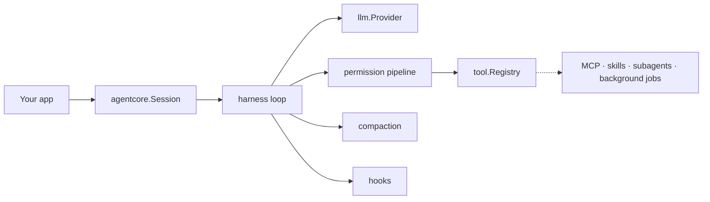

<p align="center">
  <picture>
    <source media="(prefers-color-scheme: dark)" srcset="docs/brand/banner-dark.svg">
    
  </picture>
</p>

# Corvid

[](https://pkg.go.dev/github.com/0xmanhnv/corvid)
[](LICENSE)
[](go.mod)

A general-purpose **Agent Harness SDK in Go**. Corvid is the engine that turns a language model into an autonomous agent: a streaming tool-use loop that lets a model read, run, and reason its way through a task while you keep control of the prompt, the tools, and the safety boundary.

You point it at any model (via the **Anthropic** or **OpenAI** wire format — including the OpenAI *Responses* API), drive it with a **host-controlled system prompt**, and extend it with your own tools, permission policy, hooks, and subagents. It ships as a focused, near-dependency-free library — the loop, scheduler, and safety boundary are provider- and scenario-agnostic: they don't know whether they're driving a coding agent, a security auditor, or a customer-support bot.

**What you get out of the box:** streaming over the Anthropic and OpenAI wire formats, a fail-closed tool system with the standard file/shell toolset, a four-stage permission pipeline, automatic context-window management, lifecycle hooks, subagents, MCP, plan mode, long-term memory, a skill system, background tasks, and multi-agent coordination — all behind one stateful `Session`.

Module path: `github.com/0xmanhnv/corvid` · Go 1.26+ (per [`go.mod`](go.mod); the loop streams through `iter`, added in Go 1.23).

This is a maintained fork of [Autumn-27/norma](https://github.com/Autumn-27/norma) (v0.4.4). Development happens on `dev`; `main` is the stable line, released as `v0.4.4-p.N` tags; the `mirror` branch tracks upstream unchanged. See [Acknowledgements](#acknowledgements).

Until November 2026 this fork was published as `github.com/0xmanhnv/norma`; the old URL redirects here, but Go imports must move to `github.com/0xmanhnv/corvid`.

> **New to the codebase?** Read the [architecture overview](docs/ARCHITECTURE.md) (diagrams + package map) or jump into the [documentation index](docs/README.md).

## At a glance



## Packages

| Package | Responsibility |
|---|---|
| `llm` | Vendor-neutral message model (`Message`/`ContentBlock`/`StreamEvent`) + `Provider` interface. `NewProvider(Config{Format})` builds an **Anthropic** (`FormatAnthropic`), **OpenAI Chat Completions** (`FormatOpenAI`) or **OpenAI Responses** (`FormatOpenAIResponses`) adapter; all three stream and support tool calls, normalized to one event type. Failures carry a stable `llm.Code`. |
| `tool` | `CoreTool` contract, fail-closed `Build` factory, `Registry`, a lightweight JSON-Schema validator, and the core tools: **Read, Write, Edit, MultiEdit, LS, Glob, Grep, Bash, sleep** (default set); opt-in **WebFetch** / **web_search** (network, permission-gated), **TodoWrite** (stateful planning), **AskUserQuestion** (structured mid-task questions) and the interactive PTY shell tools (`ShellSessionTools`); the background-task tools (**TaskOutput/TaskStop/TaskList/Monitor**, added unless background tasks are disabled); and **deferred tools** — schemas withheld from the model to save context, discovered on demand via `SearchExtraTools` and invoked through `ExecuteExtraTool`. |
| `permission` | The safety boundary: `allow`/`deny`/`ask` decisions, six `permission.Mode`s, allow/deny rules with deny-priority, and the four-stage `Evaluate` pipeline. |
| `harness` | The loop: `Query` streams `Event`s (`iter.Seq2`), schedules tools (concurrency-safe ones in parallel, anything else exclusively), pairs every `tool_use` with a `tool_result` (synthetic on deny/abort), enforces termination reasons, and threads cancellation. `QueryDeps` injects side effects for testing. |
| `compaction` | Non-destructive context-window management: **MicroCompact** (clear stale tool results), **AutoCompact** (summarize behind a `compact_boundary`), and **Reactive** recovery from prompt-too-long, plus a circuit breaker. Invoked skills are re-injected verbatim after each boundary so their instructions survive summarization. An opt-in **model-driven** engine (`fold`/`foldadapter`), where the model writes the summaries, is available as a mutually-exclusive alternative. |
| `hook` | Eight lifecycle hook points (PreToolUse, PostToolUse, Stop, …) as Go callbacks that can block, rewrite input, inject context, or gate the Stop transition. A `hook.Registry` plugs into `Options.Hooks`. |
| `subagent` | An `Agent` tool that delegates to isolated child agents reusing the same loop, with a recursion-depth guard. |
| `mcp` | Model Context Protocol integration: a stdio JSON-RPC client and in-process servers, exposing tools as `mcp__<server>__<tool>`. |
| `plan` | Plan mode: read-only exploration → `ExitPlanMode` presents a plan for approval → the permission mode flips mid-loop so the agent can implement. |
| `memory` | Persistent long-term memory: markdown-with-frontmatter files + a `MEMORY.md` index, relevance selection, staleness warnings, and `RecallMemory`/`RecordMemory` tools. |
| `skill` | Named, reusable instruction packages loaded from `SKILL.md` files (YAML frontmatter — `name`/`description`/`license`/`compatibility`/`mcps` — plus a Markdown body). A `Skill` tool injects a chosen skill's procedure on demand as standing guidance that survives compaction, and can unlock a skill's declared MCP tools on invocation. |
| `coordinator` | Coordinator mode: a top-level agent that decomposes work and delegates to isolated `worker` subagents — LLM-driven (Agent tool + system segment) or programmatic (`RunParallel` fan-out). |
| `agentcore` | The public entry point: a stateful `Session` whose `Prompt` streams the loop, plus a one-shot `Run`. Wires the provider, tools, permissions, compaction, plan mode, memory, skills and hooks into one session, and optionally persists an append-only JSONL transcript so a session can be resumed (`Session.Resume`). Subagents, the coordinator, MCP and `fold` plug in through its `Options`. |

## Quick start

```go
prov, _ := llm.NewProvider(llm.Config{Format: llm.FormatAnthropic, Model: "your-model-name"})
// or:  llm.Config{Format: llm.FormatOpenAI, BaseURL: "https://api.deepseek.com/v1", Model: "deepseek-chat"}

sess := agentcore.NewSession(agentcore.Options{
    Provider:       prov,
    SystemPrompt:   []string{"You are a helpful coding agent."}, // the SDK injects NO preset prompt
    PermissionMode: permission.ModeDefault,
    CanUseTool:     myApprovalCallback, // gates mutating tools
})
defer sess.Close() // stops any background tasks the agent started

for ev, err := range sess.Prompt(ctx, "Add a /health endpoint and run the tests.") {
    if err != nil { /* ... */ }
    if ev.Kind == harness.KindText { fmt.Print(ev.Text) }
}
```

## CLI demo

```bash
go build -o agentcore ./cmd/agentcore

ANTHROPIC_API_KEY=... ./agentcore -provider anthropic -model your-model-name
OPENAI_API_KEY=...    ./agentcore -provider openai    -model gpt-4o
./agentcore -provider openai -model gpt-4o -yes -p "summarize the go files here"
```

Mutating tools (Write/Edit/Bash) prompt for approval unless `-yes` is set. Supply your own system prompt with `-system FILE`.

## Design highlights

- **Several wire formats, one model.** Every adapter translates to/from a single Anthropic-style content-block model, so the loop and tools never change when you switch providers. Reasoning models' `reasoning_content` surfaces as thinking events.
- **Host owns the prompt.** The SDK ships no preset system prompt — `Options.SystemPrompt` is yours. Coding / security-audit prompts live in `examples/`, not the core.
- **Fail-closed tools.** New tools default to not-read-only, not-concurrency-safe, approval-required. A tool opts in separately to being read-only (allowed without asking) and concurrency-safe (eligible for parallel execution).
- **Stable error codes.** Failures carry an `llm.Code` next to their message (`llm.Error`, `llm.CodeOf`, `llm.IsCode`). The provider adapters classify context-window, rate-limit, auth and availability failures at their boundary; a failed tool call's code rides on its `tool_result` block (`ContentBlock.ToolError`) into events and the transcript, never to the model.
- **Typed tool output, optional.** A tool may declare its output (`tool.DeclareOutput`: a value type, its schema, a pure `Render` to model-facing content, an optional presentation-metadata projector) and return the value in `Result.Data`. The value is validated, frozen and rendered; only the rendered content enters the conversation and the transcript, while the value reaches the host through `OnToolResult`. `RewriteToolResult` is the post-execute policy point: `tool.ReplaceContent` changes what the model reads (presentation only, not a confidentiality mechanism), `tool.ReplaceValue` changes the value and renders again. Tools that build `Content` themselves keep working unchanged; `Read` and `Bash` are the reference migrations (`tool.FileLines`, `tool.CommandOutput`). MCP tools keep a server's `structuredContent` as the value.
- **Pluggable spill store.** Oversized output goes to a `tool.SpillStore` (`QueryInput.SpillStore` / `Options.SpillStore`), which returns an opaque locator and the guidance the model reads; the default, `tool.LocalSpill`, keeps files in `ToolOutputDir`.
- **Bounded background work.** Bash commands (foreground and background) run through a per-session task manager with a 50 MiB output cap and, on Linux, a per-task memory cap (`AGENT_CORE_TASK_MEM_CAP`) that kills a leaking command's process group.
- **`iter.Seq2` streaming.** `Prompt` and `Query` are range-over-func iterators; cancellation is via `context.Context`.

## Examples

- `examples/minimal` — the smallest useful agent: a provider, a host prompt, the default toolset and the streaming loop.
- `examples/custom-llm` — three provider configs + a custom non-coding prompt + a custom tool.
- `examples/coding-agent` — full coding agent with interactive permissions, a PreToolUse hook, and compaction.
- `examples/security-audit` — read-only auditor that delegates to a subagent.
- `examples/planner-memory` — plan mode (explore → approve → implement) plus persistent memory.
- `examples/coordinator` — a coordinator that fans work out to isolated worker subagents.

## Tests

```bash
go test ./...
```

The suite runs offline. It covers the provider adapters over `httptest` SSE; the loop end-to-end with a scripted provider (tool execution, message threading, permission denial, max-turns, parallel reads); real tool execution in a temp dir; the permission pipeline matrix; compaction (auto-summary, circuit breaker, micro-compact); hooks (block/rewrite/Stop-gating); subagent dispatch + depth guard; the MCP client over in-memory pipes; and the docs themselves (`docs_test.go`: relative links and anchors, cited repository paths, Mermaid ids and labels).

## Scope

Implements the core loop, the provider adapters, tools, the full permission pipeline, compaction, hooks, subagents, and MCP — plus plan mode, long-term memory, the skill system, background tasks, deferred tools, transcript persistence with resume, and coordinator multi-agent orchestration.

## Documentation

- **[Architecture](docs/ARCHITECTURE.md)** — the whole system with Mermaid diagrams and a package map.
- **[Capability matrix](docs/CAPABILITIES.md)** — what Corvid can do, which package owns it, and how to turn it on.
- **[Documentation index](docs/README.md)** — reading paths for using Corvid vs contributing to it.
- **Subsystem guides** — one page each: [agent loop](docs/guides/agent-loop.md) · [tools](docs/guides/tools.md) · [permissions](docs/guides/permissions.md) · [compaction](docs/guides/compaction.md) · [prompt caching](docs/guides/prompt-caching.md) · [subagents](docs/guides/subagents.md) · [MCP](docs/guides/mcp.md) · [skills](docs/guides/skills.md) · [memory](docs/guides/memory.md) · [jobs](docs/guides/jobs.md).
- **[Contributing](CONTRIBUTING.md)** — build, test, layout, and conventions.
- **Package reference** — [pkg.go.dev/github.com/0xmanhnv/corvid](https://pkg.go.dev/github.com/0xmanhnv/corvid); every package opens with a precise doc comment.

## Acknowledgements

Corvid is a maintained fork of **[Autumn-27/norma](https://github.com/Autumn-27/norma)** by Autumn-27, the original author and copyright holder, released under the Apache License 2.0. This fork builds on that work; the upstream copyright notice is preserved in [`LICENSE`](LICENSE). Development of the fork happens on `dev`, `main` holds releases, and `mirror` tracks upstream.

Corvid's archive-backed context-compression package (`fold` / `foldadapter`) uses code
from **acp-kernel** by ranxianglei (<https://github.com/ranxianglei/acp-kernel>),
including code that acp-kernel took from **billion-context**
(<https://github.com/ranxianglei/billion-context>). Both are MIT-licensed; acp-kernel
releases from v0.0.98 on add an attribution term, which this notice and
[`THIRD-PARTY-LICENSES.md`](THIRD-PARTY-LICENSES.md) satisfy for Corvid. If you build a
user-facing product on Corvid that ships this package, see the downstream obligation in
that file.

## License

Apache License 2.0 — see [`LICENSE`](LICENSE). Copyright 2026 Autumn-27.

Corvid also bundles source derived from third-party work under its own license: the
`fold` / `foldadapter` compression engine is ported from acp-kernel (MIT, plus an
attribution term for code taken from v0.0.98 on). The required notices and full license
texts are listed in [`THIRD-PARTY-LICENSES.md`](THIRD-PARTY-LICENSES.md).
