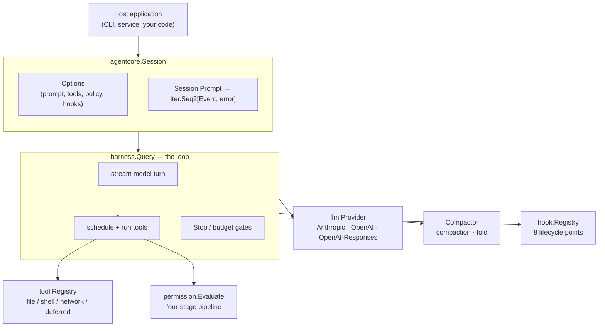
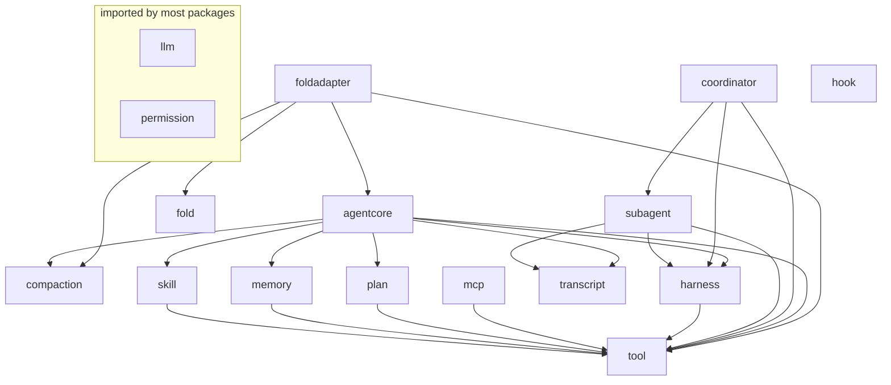
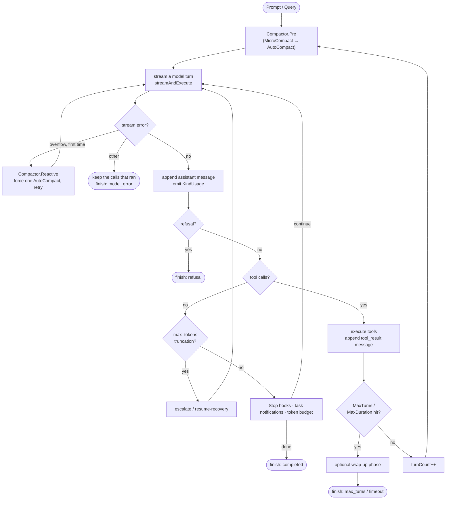
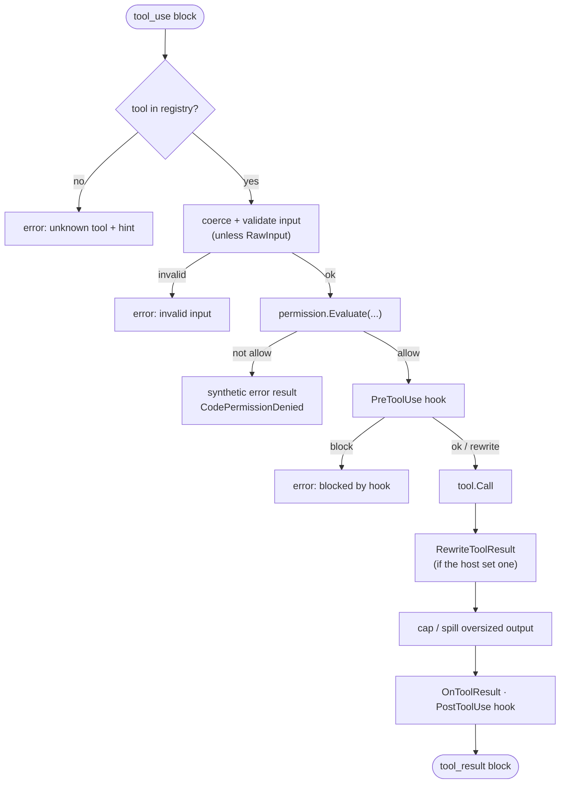
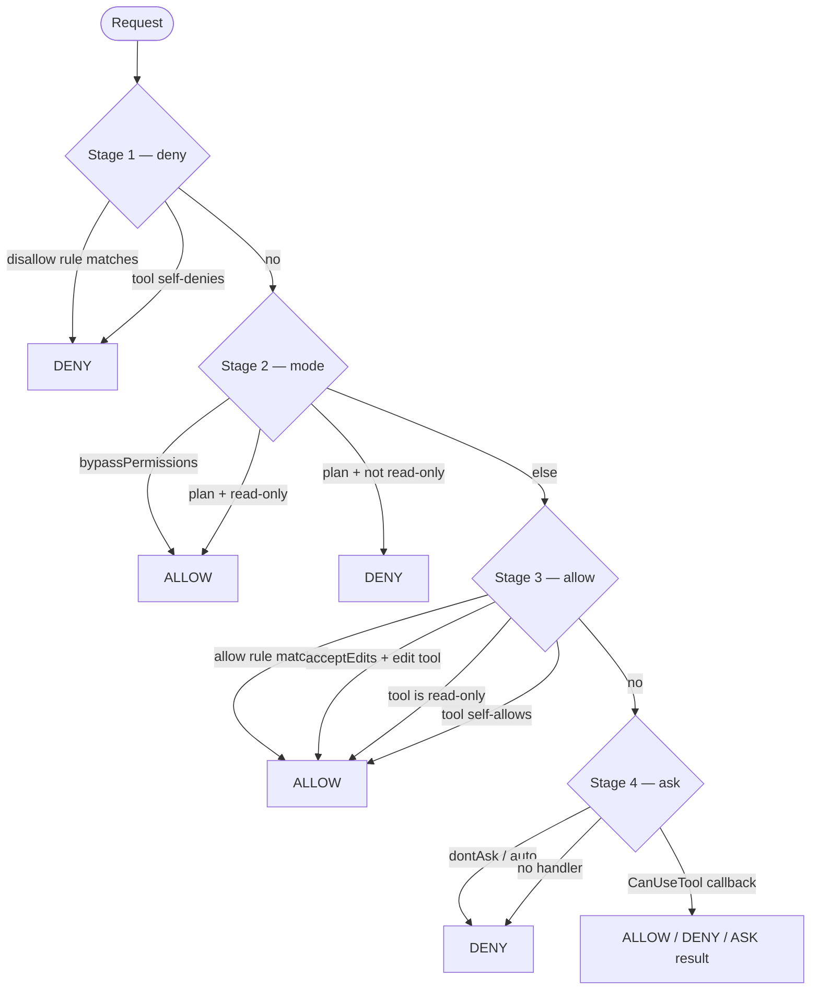
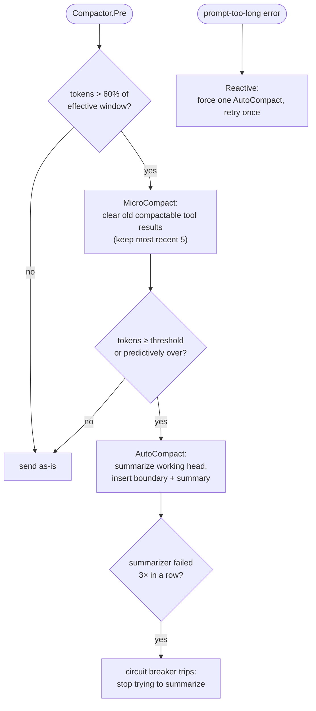
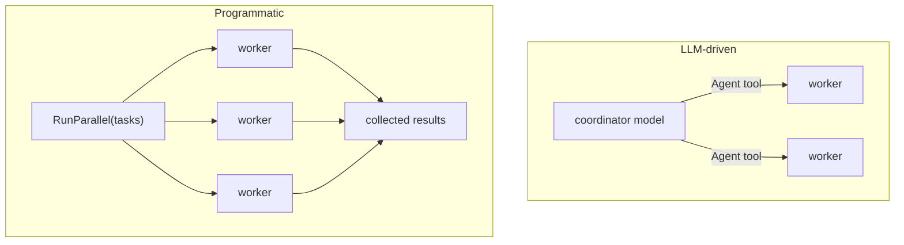
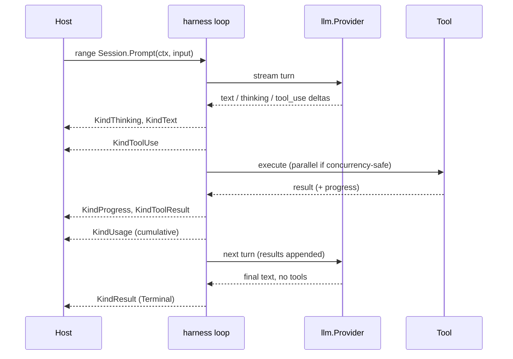

# Corvid Architecture

> How the pieces fit together, verified against the source on the `dev` branch.
> Every diagram below reflects real control flow; package and file paths are cited so
> you can read the code next to the prose. When a doc and the code disagree, the code wins —
> please open an issue.

Corvid is an **agent harness**: the machinery that turns a language model into an
autonomous agent. A host supplies a model, a system prompt, a set of tools, and a
safety policy; Corvid runs the loop that lets the model think, call tools, observe
results, and continue until it is done — while the host keeps control of every
boundary that matters.

- [1. The big picture](#1-the-big-picture)
- [2. Package map](#2-package-map)
- [3. The agent loop](#3-the-agent-loop)
- [4. Tools and the permission pipeline](#4-tools-and-the-permission-pipeline)
- [5. Context and compaction](#5-context-and-compaction)
- [6. Subagents and coordination](#6-subagents-and-coordination)
- [7. MCP, skills, memory, plan mode, hooks](#7-mcp-skills-memory-plan-mode-hooks)
- [8. Background jobs](#8-background-jobs)
- [9. Streaming and the event model](#9-streaming-and-the-event-model)
- [10. Transcript and resume](#10-transcript-and-resume)

---

## 1. The big picture

A single stateful `Session` (`agentcore/agentcore.go`) is the public entry point.
It composes a provider, a tool registry, a permission policy, hooks, and an optional
context manager, then streams the loop implemented in `harness`.

Three principles are wired into the structure and worth stating up front:

- **The host owns the prompt.** The SDK injects no preset system prompt; it only
  ever adds a small `<system-reminder>` carrying the current date plus anything the
  host opts into (`agentcore.buildSystemReminder`). Scenario prompts live in
  `examples/`, never in the core.
- **Tools fail closed.** A tool built through `tool.Build` defaults to *not*
  read-only, *not* concurrency-safe, and *approval-required* (`tool/tool.go`). A
  tool becomes parallelizable or auto-allowed only by opting in.
- **Streaming is an iterator.** `Session.Prompt` and `harness.Query` are
  range-over-func iterators (`iter.Seq2[Event, error]`); cancellation is a plain
  `context.Context`.

---

## 2. Package map

Each top-level directory is one Go package with one job. Dependencies flow one
way: `llm`, `permission` and `fold` import nothing else in the tree; `agentcore`
composes the core packages; the add-ons (`subagent`, `coordinator`, `mcp`, `hook`,
`foldadapter`) sit outside it and are wired in through `agentcore.Options`.

The graph shows the direct imports between packages. Edges into the two leaves
that most packages import, `llm` and `permission`, are left out to keep it
readable; the table lists them.

| Package | Owns | Depends on |
|---|---|---|
| `llm` | Vendor-neutral message model (`Message`, `ContentBlock`, `StreamEvent`, `Usage`), the `Provider` interface, the Anthropic / OpenAI / OpenAI-Responses adapters, and the stable error taxonomy (`llm.Error`, `llm.Code`). | stdlib only |
| `tool` | The `CoreTool` contract, the fail-closed `Build` factory, the `Registry`, input validation/coercion, typed output, spill stores, the background-task `Manager`, and the built-in tools. | `llm`, `permission` (+ `golang.org/x/net`, a PTY library and a terminal emulator) |
| `permission` | The safety boundary: decisions, modes, rule matching, and the four-stage `Evaluate` pipeline. | stdlib only |
| `harness` | The loop: streaming a turn, scheduling and executing tools, recovery, Stop/budget gates, cancellation. | `llm`, `tool`, `permission` |
| `compaction` | Built-in context-window management (MicroCompact, AutoCompact, Reactive) with a circuit breaker. | `llm` |
| `hook` | Eight lifecycle callbacks; a `Registry` that satisfies `harness.HookRunner`. | `llm` |
| `subagent` | Delegation to isolated child agents via an `Agent` tool, with a depth guard. | `harness`, `llm`, `permission`, `tool`, `transcript` |
| `coordinator` | A top-level agent that fans work out to `worker` subagents (LLM-driven or programmatic). | `subagent`, `harness`, `llm`, `permission`, `tool` |
| `mcp` | Model Context Protocol: a stdio JSON-RPC client and in-process servers, each tool adapted as `mcp__<server>__<tool>`. | `llm`, `permission`, `tool` |
| `plan` | Plan mode: read-only exploration, then approval flips the permission mode mid-loop. | `permission`, `tool` |
| `memory` | File-backed long-term memory with a `MEMORY.md` index and recall/record tools. | `permission`, `tool` |
| `skill` | Named instruction packages loaded from `SKILL.md`; a `Skill` tool injects one on demand. | `llm`, `permission`, `tool` (+ `gopkg.in/yaml.v3`) |
| `transcript` | Append-only JSONL persistence and reconstruction for resume. | `llm` |
| `fold` | An opt-in, model-driven context-compression engine: a pure core that decides *when* and *what* to compress while the model writes the summaries. | stdlib only |
| `foldadapter` | Wires `fold` into a `Session` (a `Compactor` + a `Compress` tool + resident prompt). | `fold`, `agentcore`, `compaction`, `llm`, `permission`, `tool` |
| `agentcore` | The public `Session` / `Options` / `Run` entry point. It builds the tool registry, permission settings, context manager, plan mode, memory, skills and transcript for a session and runs the loop. | `harness`, `compaction`, `plan`, `memory`, `skill`, `transcript`, `tool`, `permission`, `llm` |

`cmd/agentcore` is a runnable CLI demo; `examples/` holds scenario wiring. Neither is
imported by the library.

---

## 3. The agent loop

The loop lives in `harness/query.go` (`loop.run`). One iteration is a **turn**: an
optional compaction pass, one model call, then — if the model asked for tools — a
tool-execution phase and another iteration. The loop ends when the model stops
asking for tools (and no gate forces continuation) or when a budget or error path
terminates it.

Key invariants, each enforced in `loop.run`:

- **Non-destructive context.** The loop keeps the full history in `l.messages` and
  sends only the API-visible projection to the model. Compaction inserts boundaries
  and summaries; it never deletes history.
- **Every `tool_use` gets a `tool_result`.** A denied, blocked, or aborted call
  still produces a synthetic error result (`harness/tools.go: toolFailure`) so the
  conversation the provider sees is always well-formed.
- **Budgets are checked at the turn boundary, never mid-stream.** `MaxTurns` and
  `MaxDuration` are evaluated after a tool phase completes, so a turn is never cut
  in flight. The one exception is a tool that overruns `MaxDuration`: its
  `toolCtx` deadline interrupts it, and the loop then enters the wrap-up phase on
  the live parent context rather than aborting.
- **Termination is typed.** Every exit carries a `harness.TerminalReason`
  (`completed`, `max_turns`, `timeout`, `model_error`, `refusal`, `prompt_too_long`,
  `aborted_streaming`, `aborted_tools`, `stop_hook_prevented`, `hook_stopped`,
  `blocking_limit`, `image_error`) on the final `KindResult` event (`harness/event.go`),
  along with the provider's stop reason for the last model turn.
- **An incomplete tool call never runs.** A call still arriving when the stream
  breaks is dropped; a call whose arguments were cut off by `max_tokens` is answered
  with a `truncated` error. Calls that did run before a stream error stay in the
  conversation and the transcript with their results.

### Continuation gates

When the model stops asking for tools, the loop does not immediately finish. In
order (`loop.run`): Stop hooks may force continuation with injected feedback;
background-task completions are drained in and provoke another turn; and if a
`TokenBudget` is set, the agent is nudged to keep working until roughly 90% of the
budget or diminishing returns. Only when none fire does the loop finish `completed`.

---

## 4. Tools and the permission pipeline

A tool is anything satisfying `tool.CoreTool` (`tool/tool.go`): a name, a
description, a JSON-Schema input, two behavioral predicates (`IsReadOnly`,
`IsConcurrencySafe`), a permission self-check (`CheckPermissions`), and `Call`.
Most tools are built with `tool.Build(Spec{...})`, which fills unset fields with
fail-closed defaults.

### Executing one call

`harness/tools.go: loop.execOne` is the single choke point every tool call passes
through:

Two details make this robust: input is **coerced** before validation (common
mistypings like a number sent as a string are repaired, `tool.CoerceInput`), and
**every** tool's output — built-in, MCP, custom, or host — passes through one output
cap so no single tool can overflow the context window.

### The four-stage pipeline

`permission.Evaluate` (`permission/permission.go`) combines the tool's own verdict
with the host's rules and the active mode. The order encodes **deny-priority**: an
explicit deny wins over every mode, including bypass.

The six modes (`permission.Mode`): `default` (ask for anything not read-only unless
a rule allows), `acceptEdits` (auto-allow Write/Edit/NotebookEdit), `bypassPermissions`
(allow all except deny rules), `plan` (read-only only), and `dontAsk` and `auto`
(never prompt: whatever stage 3 does not allow is denied). In `Evaluate` the last
two behave the same; they differ only in their denial message and in how strict
`harness.StricterMode` ranks them when a subagent's mode is reconciled with its
parent's (`auto` counts as less strict).

### The built-in toolset

`tool.DefaultTools()` returns **Read, Write, Edit, MultiEdit, LS, Glob, Grep, Bash**,
plus **sleep** (a context-cancellable wait that pairs with background execution).
A `Session` also adds the background-task tools (**TaskOutput, TaskStop, TaskList,
Monitor**) unless background tasks are disabled. Everything else is opt-in through
its own constructor or `Options` field: network tools (**WebFetch**, **web_search**),
stateful planning (**TodoWrite**), structured questions (**AskUserQuestion**), the
interactive PTY shell tools (`tool.ShellSessionTools`: shell_open, shell_send,
shell_read, shell_list, shell_close), and **deferred tools**, whose schemas are
withheld from the model to save context and discovered on demand via
`SearchExtraTools` / `ExecuteExtraTool`.

---

## 5. Context and compaction

Corvid keeps a conversation inside the model's window **non-destructively**: history
is retained in full; only the projection sent to the provider shrinks. There are two
independent, mutually exclusive context managers — a session holds exactly one.

### Built-in compaction (`compaction`)

Three mechanisms run from `Compactor.Pre` (and `Reactive`) in `compaction/compaction.go`:

- **MicroCompact** clears the bodies of stale *compactable* tool results
  (file reads, shell, grep/glob, web, edit/write), keeping the most recent five, once
  the context passes 60% of the effective window (the window minus the summary
  reservation). It is non-destructive: a cleared result can be re-read.
- **AutoCompact** summarizes the working head behind a `compact_boundary` marker at
  the token threshold, or predictively when the next turn would overflow. The full
  history stays in the array; only messages after the last boundary are sent
  (`llm.MessagesForAPI`). Thresholds are derived from the window minus a summary
  reservation and a tiered buffer.
- **Reactive** handles a `prompt-too-long` (413) error by forcing one AutoCompact and
  retrying the turn exactly once (`loop.run`, guarded by `hasAttemptedReactiveCompact`).
- A **circuit breaker** (`maxAutoCompactFails = 3`) stops the compactor from
  retrying a summarizer that keeps failing.

> Note: `Snip` and `Context-Collapse` are **intentionally absent** — see the package
> doc comment in `compaction/compaction.go` for why. (Earlier descriptions that list
> them are stale.)

**Skill re-injection.** When a boundary summarizes over a skill invocation, the
summary is lossy for procedural instructions. AutoCompact re-injects the latest
invocation of each affected skill verbatim just after the summary, newest-first,
under a per-skill and total token budget, so standing guidance survives compaction
(`compaction.reinjectSkills`).

### Model-driven compression (`fold` / `foldadapter`)

`fold` is an opt-in alternative that inverts the usual model: instead of the harness
summarizing, the **model** writes the summaries through a `Compress` tool, and `fold`
decides *when* to compress, *which* range, tracks state, and prunes. The core is a
pure library with no I/O and no model calls — the summarizer is reduced to a string
argument. It plugs in as a `harness.ContextView` that projects the request view per
turn without mutating history.

`foldadapter.Enable(opts, …)` is the single, all-or-nothing entry point: it attaches a
`Compactor`, adds the `Compress` tool, and appends the resident prompt sections
together (they must live or die together). Enabling it disables the built-in
`compaction` — the two are mutually exclusive, enforced in `agentcore.NewSession`.
Originals are preserved in a host-specified archive directory, and compression state
can be inherited across forks and subagents.

See the [compaction guide](guides/compaction.md) for the full walkthrough.

---

## 6. Subagents and coordination

A **subagent** (`subagent/subagent.go`) is the same harness loop run with its own
prompt, tool subset, and permission mode — giving context isolation. It is exposed
to the parent as an `Agent` tool; recursion is bounded by a depth guard carried on
the context (`MaxDepth`, default 3). A child inherits its parent's deny and allow
rules, and runs in the stricter of its own and its parent's permission mode
(`harness.StricterMode`), so delegation never loosens the policy.

**Coordinator mode** (`coordinator/coordinator.go`) is a pattern on top of subagents:
a top-level agent that decomposes work and delegates each unit to isolated `worker`
subagents rather than doing it itself. Two paths:

The LLM-driven path exposes the `Agent` tool plus a system segment so the model
spawns workers itself; the programmatic `RunParallel` fans tasks out concurrently
(bounded by `MaxParallel`, default 4) and returns their results.

---

## 7. MCP, skills, memory, plan mode, hooks

- **MCP** (`mcp/mcp.go`) speaks JSON-RPC 2.0 over newline-delimited stdio to external
  servers and also supports in-process servers (plain Go functions). Every MCP tool
  is adapted to a `tool.CoreTool` named `mcp__<server>__<tool>`, so the rest of the
  system treats it like any other tool.
- **Skills** (`skill/skill.go`) are named instruction packages: a `SKILL.md` with
  YAML frontmatter (`name`, `description`, optional `license` / `compatibility` /
  `mcps`) plus a Markdown body. Invoking one injects its procedure as an independent
  message that becomes standing guidance (and is re-injected across compaction
  boundaries). A skill may declare MCP servers in `mcps`; the host's
  `skill.Registry.OnInvoke` callback unlocks their deferred tools when it loads.
- **Memory** (`memory/memory.go`) stores facts as Markdown-with-frontmatter files
  indexed by `MEMORY.md`. The agent recalls relevant memories and records new ones
  via tools; with `AutoInject`, the most relevant memories are appended to each
  prompt.
- **Plan mode** (`plan/plan.go`) runs the agent read-only (mode `plan`), either from
  the start (`PlanOptions.StartInPlanMode`) or once the model calls `EnterPlanMode`.
  It explores, drafts a plan, and calls `ExitPlanMode` to present it. On approval a
  `Controller` flips the live permission mode to the target (default `acceptEdits`);
  the harness reads the mode through `QueryInput.PermissionModeFunc` so the change
  takes effect mid-loop.
- **Hooks** (`hook/hook.go`) are Go callbacks at eight points: `PreToolUse` (may block
  the call or rewrite its input), `PostToolUse` / `PostToolUseFailure`, `Stop` (may end
  the run or force another turn), `UserPromptSubmit` (may add context to the prompt),
  `SessionStart`, `SessionEnd` and `SubagentStart`. A `hook.Registry` goes in
  `Options.Hooks`. The loop fires the tool and Stop hooks, `Session.Prompt` fires
  `SessionStart` (on the first prompt) and `UserPromptSubmit`, and the `Agent` tool
  fires `SubagentStart` when its `subagent.Config.Hooks` is a registry. Nothing fires
  `SessionEnd` for you: call `Registry.FireSessionEnd` when the host is done.

---

## 8. Background jobs

When background tasks are enabled, a per-session `tool.Manager` runs long commands
out of band, and the loop drains their completion notifications into the conversation
between turns (`loop.injectTaskNotifications`) so the model learns when work finishes
— including provoking an extra turn so it can react. **Bash** with
`run_in_background` and **Monitor** start tasks; **TaskOutput**, **TaskList** and
**TaskStop** read and control them. On Linux every spawned task is also
bounded by a per-task memory cap (`AGENT_CORE_TASK_MEM_CAP`, default 80% of the
cgroup or host memory budget) that kills the process group of a leaking command; see
[jobs → Safety](guides/jobs.md#safety).
Background tasks can be disabled globally
(`AGENT_CORE_DISABLE_BACKGROUND_TASKS`) or per-session (`Options.DisableBackgroundTasks`).

---

## 9. Streaming and the event model

`harness.Query` yields `harness.Event` values (`harness/event.go`). A host ranges over
the iterator and reacts to each kind; the final event is always `KindResult`, unless
the host stops ranging early (`QueryInput.OnExit` still sees how the run ended).

Tools begin executing the moment their `tool_use` block finishes streaming
(`harness/streaming.go`), subject to a **FIFO + exclusivity** rule: concurrency-safe
tools run alongside each other, a non-safe tool requires exclusive access, and
results are surfaced in FIFO order. The default concurrency bound is 10
(`MaxConcurrency`).

A `NonStreaming` option runs each model call as a single request instead of a token
stream; the host receives the same event sequence, just delivered when the full
response arrives.

---

## 10. Transcript and resume

With a `transcript.Store` configured, the loop persists the conversation as an
append-only JSONL log through a `Recorder` (`harness/query.go`). It records every
message as it is born, in order, so the log holds the full-fidelity history. When
compaction inserts a boundary, the boundary marker, the summary and a second copy of
the kept recent tail are recorded, plus a separate boundary record for observability;
MicroCompact's tool-result clearing is never recorded. `Session.Resume(id)` reloads
the log and rebuilds the message history and cumulative usage. A trailing tool call
whose result never landed (a crash mid-tool) is kept and answered with a synthetic
error result saying the call was interrupted and may have executed, so the model
checks before repeating a side effect and the provider never sees a dangling
`tool_use`; that result is appended to the log as well. Each append is a single
write of the record and its newline, and `Store.SetSync` adds an fsync per append. A
line that cannot be decoded — the last one, when a write was cut short — is skipped
instead of failing the file: `Store.LoadReport` lists what was skipped, and `Resume`
passes it to `Options.OnWarn`. Because the post-boundary working set is in the log, a resumed
session continues from the compacted view instead of summarizing again. A rewind
record (`transcript.Store.Rewind`) moves the conversation back to an earlier message
without deleting anything from the file. Subagents write their own sidechain files
under the same store.

---

## Where to read next

- [docs/README.md](README.md) — the documentation index and reading paths.
- The per-subsystem guides under [docs/guides/](guides/).
- The package doc comments — every package opens with a precise summary, and they are
  the canonical source this document is built from.
