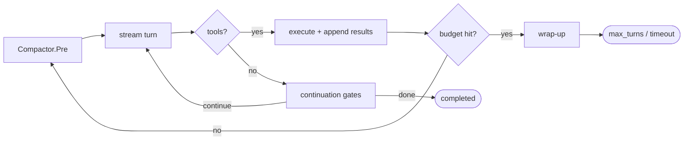

# Agent loop

> Package `harness` · `harness/query.go`, `harness/event.go`, `harness/streaming.go`

The loop is the heart of Corvid. Everything else — tools, permissions, compaction,
subagents — is something the loop calls into. This guide explains what one call to
`Session.Prompt` actually does.

## One turn

`harness.Query` returns an `iter.Seq2[Event, error]`. Internally it builds a `loop`
and runs `loop.run` (`harness/query.go`). One iteration of that loop is a **turn**:

1. **Proactive compaction.** If a `Compactor` is configured, `Compactor.Pre`
   conditions the history before the request (non-destructive).
2. **Stream the model turn.** `streamAndExecute` streams the completion, surfacing
   `KindThinking` / `KindText` / `KindToolUse` events, and begins executing tool
   calls as soon as each `tool_use` block finishes streaming.
3. **Append and account.** The assistant message is appended; cumulative token usage
   is surfaced as `KindUsage`.
4. **Branch on tool calls.**
   - *No tool calls* → run the continuation gates (below). If none fire, finish
     `completed`.
   - *Tool calls* → append the `tool_result` message, drain background-task
     notifications, check budgets at the turn boundary, and loop again.



## Continuation gates

When the model stops asking for tools, the loop does **not** always stop. In order:

- **Stop hooks** (`HookRunner.Stop`) may hard-terminate (`stop_hook_prevented`) or
  force another turn by injecting blocking feedback. A guard (`stopHookActive`)
  prevents an always-blocking hook from looping forever without an intervening turn.
- **Background-task notifications** that landed are drained into the conversation; if
  any did, the loop takes another turn so the model can react.
- **Token budget.** If `TokenBudget > 0`, the agent is nudged to keep working until
  roughly 90% of the output budget or diminishing returns (`checkBudgetContinue`).

Only when none of these fire does the loop finish `completed`.

## Recovery paths

The loop recovers from these provider failure modes without the host doing anything:

- **Prompt too long (overflow).** On the first overflow error the loop asks the
  compactor to force one `Reactive` AutoCompact and retries the turn once
  (`hasAttemptedReactiveCompact`). If recovery is unavailable it finishes
  `prompt_too_long`.
- **`max_tokens` truncation with no tool calls.** The loop can escalate the output
  cap (if `EscalateMaxTokens` is set: to the model's declared limit,
  `ModelSettings.MaxOutputTokens`, or 64000 when that is unknown) and/or run
  resume-recovery, bounded by `maxOutputTokensRecoveryLimit = 3`, before surfacing
  the truncated turn.
- **A tool call cut off by `max_tokens`.** When a turn stops at the output limit in
  the middle of a tool call's arguments, the call is not run. Streaming, the loop
  sees the arguments end early; on a whole response (`NonStreaming`) the adapter
  marks the call `ContentBlock.Truncated`. It is answered
  with a `truncated` error result (`tool.CodeTruncated`) telling the model the call
  was cut off and to retry with a smaller one; calls that arrived whole before it run
  as usual. With `EscalateMaxTokens` set, the following turns get the raised output
  cap until one fits. This one is an ordinary tool turn and does advance `turnCount`.

The first two are *retries of the same turn* — they do not advance `turnCount`.

### A stream that breaks mid-turn

A model stream can fail after part of the turn has arrived. A tool call still being
received at that point is incomplete and is never run. Calls that had arrived whole
have already started (tools run while the stream is still arriving): the loop waits
for them, then appends the assistant turn as far as the last of those calls and their
results to the conversation and the transcript. The run still finishes `model_error`
(or `aborted_streaming` on cancellation), but a retry or a resume sees what ran
instead of repeating it. If no call had started, nothing is appended.

### Refusal

A turn that ends with the provider's `refusal` stop reason finishes the run with the
reason `refusal`, not `completed`. `Terminal.Err` carries `llm.CodeRefusal`, so
`agentcore.Run` returns an error for it. Any text that came with the refusal is kept
as the assistant message and in `Terminal.Text`; a refusal with no content appends no
assistant message at all.

## Budgets and the wrap-up phase

`MaxTurns` and `MaxDuration` are checked at the **turn boundary**, never mid-stream,
so a turn is never cut in flight. When a budget is hit, an optional **Settlement**
phase runs a short wrap-up (injecting a prompt, turning some tools off) so a
budget-terminated run can write down what it has. Calls to `DisabledTools` are
refused with an error result; their schemas stay in the request, so the wrap-up
turns still read the prompt cache. `HideDisabledTools` removes the schemas too, at
the price of sending the history uncached. The run still finishes with the
budget's reason, never `completed`. The one case that interrupts a tool mid-flight is
a tool overrunning `MaxDuration`: its `toolCtx` deadline fires, and the loop enters
wrap-up on the live parent context instead of aborting.

## Termination reasons

Every exit carries a typed `TerminalReason` on the final `KindResult` event
(`harness/event.go`): `completed`, `max_turns`, `timeout`, `model_error`,
`refusal`, `prompt_too_long`, `aborted_streaming`, `aborted_tools`,
`stop_hook_prevented`, `hook_stopped`, `blocking_limit`, `image_error`,
`stop_requested`, `context_exhausted`. The `Terminal`
struct also carries the error (if any), the stop reason the provider gave for the
last model turn (`StopReason`), the run's own usage, what its subagents used
(`SubagentUsage`, kept separate), the turn count, a full message snapshot, and the
assistant's final text. `Terminal.Usage` covers that one `Prompt`;
`Session.Usage()` is the running total for the session, including what a resumed
transcript had recorded, and `Session.LastUsage()` is the most recent prompt alone. If the host stops ranging before the end, no `KindResult` is sent;
`QueryInput.OnExit` still receives a `Terminal` with reason `consumer_stopped`.

## Ending a run from the host

`QueryInput.StopCheck` is called before every model call, after compaction has had
its turn. It sees a `RunState` (turn number, messages, the last reported request
size, usage so far) and can return a `StopRequest` to end the run there:

```go
in.StopCheck = func(ctx context.Context, st harness.RunState) *harness.StopRequest {
    // compactor is the *compaction.Compactor the run uses.
    if f := compactor.Fit(st.Messages); !f.Fits {
        return &harness.StopRequest{
            Reason: harness.ReasonContextExhausted,
            Detail: fmt.Sprintf("prefix %d + kept tail %d exceed the window %d", f.Prefix, f.Tail, f.Window),
        }
    }
    return nil
}
```

`compaction.Compactor.Fit` measures what no compaction can shrink, the system prompt
and tools plus the most recent turn, against the window.

The run ends with that reason and `Terminal.Detail`. `context_exhausted` also gets
an error carrying `llm.CodeContextOverflow` unless the request names its own; a
request with no reason ends as `stop_requested`. Use it when you know the run cannot
go on (compacting again would free nothing, a spending limit is reached) instead of
waiting for the provider to reject a request.

## Output cap

`QueryInput.MaxTokens` is the output cap of each request. Left at 0 it is the model's
declared output limit, `ModelSettings.MaxOutputTokens`; when that is 0 too, the loop
sends no cap and the adapter applies its own default (8192 on the Anthropic format,
nothing on the OpenAI format). An explicit `MaxTokens` above the declared limit is
lowered to it.

## Streaming vs non-streaming

By default each turn is a token stream. `QueryInput.NonStreaming` (exposed as
`Options.NonStreaming`) runs each model call as a single request via
`Provider.Complete`; the host receives the same event sequence, just delivered when
the full response arrives.

## Testing seam

`QueryDeps` injects the side-effect boundaries — `CallModel`, `CallModelSync`,
`NewID` — so the entire loop can be driven by a scripted provider with no network.
This is how the harness tests exercise tool execution, message threading, permission
denial, max-turns, and parallel reads end to end.
