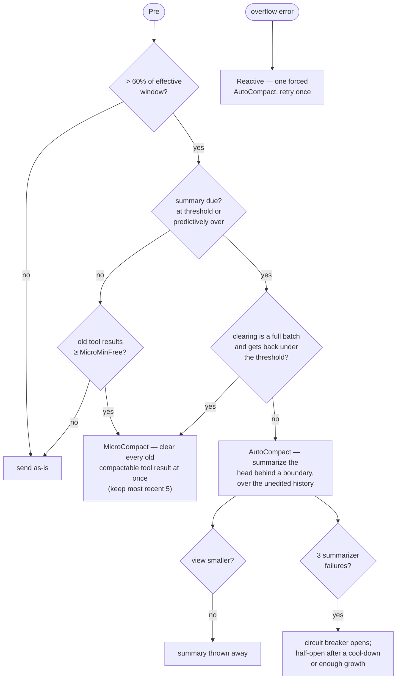

# Compaction

> Packages `compaction` and `fold` / `foldadapter`
> · `compaction/compaction.go`, `foldadapter/fold.go`

A long-running agent will eventually produce more conversation than fits the model's
context window. Corvid handles this **non-destructively**: the full history is always
retained in the message array; only the projection sent to the provider shrinks. A
session has exactly one context manager — the built-in compactor **or** the
model-driven engine, never both (`agentcore.NewSession` enforces this).

## The harness contract

The loop talks to a context manager through the `harness.Compactor` interface:

- `Pre(ctx, msgs, lastInputTokens)` conditions history before a request.
- `Reactive(ctx, msgs)` force-compacts after an overflow error.
- `IsOverflow(err)` recognizes a prompt-too-long failure.

A compactor that also implements `harness.ContextView` builds the request message
array itself (replacing `llm.MessagesForAPI`) — the seam the model-driven engine uses.

## Built-in compaction

Enabled with `Options.Compaction = &compaction.Config{...}`. Three mechanisms run
from `Compactor.Pre` / `Reactive` (`compaction/compaction.go`):



- **MicroCompact** clears the bodies of stale *compactable* tool results — file reads,
  shell, grep/glob, web, edit/write — keeping the most recent five. It can run once the
  context passes 60% of the effective window (the window minus the summary
  reservation), but only **in batches**: a pass waits until clearing everything old
  frees at least `MicroMinFree` tokens, clears it all at once, and leaves the history
  byte-identical until the next pass. Editing an earlier message makes the provider
  bill everything after it as new input, so one result per turn would cost more than it
  saves (see [prompt caching](prompt-caching.md)). A cleared result keeps its
  `tool_use` / `tool_result` pair and can be re-read, so nothing is lost.
- **AutoCompact** summarizes the messages between the last boundary and the preserved
  recent tail, inserts a `compact_boundary` marker plus the summary, and retains
  everything before it. Only messages after the last boundary are sent to the model.
  Thresholds derive from the window minus a summary reservation and a tiered buffer;
  a predictive check compacts *before* the next turn would overflow. A summary that
  does not make the view smaller is thrown away and the history left as it was.
- **Reactive** handles an overflow error by forcing one AutoCompact and retrying the
  turn exactly once. If Pre has just rejected a summary on the same turn, it does not
  ask for a second one.
- A **circuit breaker** (`maxAutoCompactFails = 3`) stops retrying a summarizer that
  keeps failing. It is not permanent: after `BreakerCooldown`, or once the
  conversation has grown by `BreakerRegrowth` tokens, one summary is tried again;
  success closes the breaker.

### The kept tail

The tail AutoCompact preserves is a **token budget cut at turn boundaries**, not a
message count. It is the longest run of recent turns that fits `KeepRecentTokens` (and
at most `KeepRecent` messages), and it always:

- starts on an assistant message, so the view after the boundary reads summary (user),
  assistant, user, … with roles alternating;
- keeps a `tool_use` on the same side of the cut as all of its `tool_result`s, parallel
  calls included.

The most recent turn is kept even when it is over the budget. When that turn alone is
larger than what fits beside a summary, no summary can help: compaction reports
`ReasonMessageExceedsBudget` and makes no model call.

`Compactor.Fit(messages)` asks the same question ahead of time: it measures the fixed
prefix (system prompt and tools) plus the most recent turn against the window and
reports `Fits: false` when no summary can make the next request fit. Call it from
`harness.QueryInput.StopCheck` to end such a run with `ReasonContextExhausted` instead
of compacting in circles (see [the agent loop](agent-loop.md#ending-a-run-from-the-host)).

### Config

```go
compaction.Config{
    ContextWindow:    200000, // model window in tokens (default 200000)
    MaxOutputTokens:  8000,   // summary reservation is min(MaxOutputTokens, 20000) (default 8000)
    KeepRecent:       8,      // most messages the kept tail may hold (default 8)
    KeepRecentTokens: 0,      // token budget of the kept tail (default: a fifth of the effective window)
    MicroMinFree:     0,      // least a MicroCompact pass must free (default: a tenth of the effective window)
    BreakerCooldown:  0,      // time before a tripped breaker is tried again (default 5 minutes)
    BreakerRegrowth:  0,      // or growth, in tokens, before it is tried again (default: a tenth of the effective window)
    StaticPrefixTokens: 0,    // measured size of system prompt + tool schemas (default: estimated)
    TokenCalibration:   0,    // tokens = characters/4 × this (default 4/3, or learned from usage)
    Summarizer:       nil,    // replaces the session's summarizer (see below)
    OnEvent:          nil,    // called for every pass and every skipped pass
}
```

AutoCompact fires at the effective window minus a buffer of 13k tokens (30k from a
400k effective window, 50k from 800k), or earlier when the next turn could add more
than the summary reservation plus 15k tokens and overflow.

### Who writes the summary

By default the session's own `Provider` does (`compaction.ProviderSummarizer`), and
the request is built **on the run's own prefix**: the same tools and system prompt,
the conversation as the next turn would send it, and the instruction to summarize as
the last message. Because that request starts with exactly what the previous turn
sent, the provider reads the history from its prompt cache instead of billing it as
new input. The tools are listed only to keep the prefix identical; the instruction
forbids calling them, and a reply with no text in it is retried, never used.

What the summary cost is added to the run's usage (`Compactor.TakeUsage`).

To summarize with a different, cheaper model:

```go
compaction.Config{
    Summarizer: compaction.StandaloneSummarizer(cheapProvider, 8000, false),
}
```

A standalone summary carries its own short system prompt, no tools, only the part
being summarized, and no cache markers. It cannot read the session's cache — a cache
belongs to one model — so weigh the cheaper price against paying for that input in
full.

### Knowing what happened

`Config.OnEvent` receives a `compaction.Event` for every pass, whether `Pre` decided
it (`Trigger: "auto"`) or `Reactive` was asked for it (`"reactive"`), with
`TokensBefore`, `TokensAfter`, and how much was summarized or cleared. A pass that was
due and did not happen is reported too, with a `Reason`:

| Reason | Meaning |
|---|---|
| `no_summarizer` | no summarizer is configured |
| `breaker_open` | the summarizer failed repeatedly and is being rested |
| `nothing_to_summarize` | everything since the last boundary is in the kept tail |
| `message_exceeds_budget` | cannot compact: one message exceeds the budget |
| `summary_failed` | the summarizer returned an error (`Event.Err`) |
| `summary_not_smaller` | the summary did not shrink the view and was thrown away |
| `summary_rejected_this_turn` | a summary was already thrown away on this turn |
| `cancelled` | the run's context ended during the summary |

### Counting tokens

The provider's reported usage is used whenever a response carried it. Otherwise the
size is estimated locally as characters / 4 × a calibration factor, plus the static
prefix (system prompt and tool schemas). The factor defaults to 4/3 and is learned
from reported usage as the session goes; set `TokenCalibration` for content that is
dense from the first request (hex, base64, JSON run near 2), and `StaticPrefixTokens`
if you have measured your tools and system prompt.

### Hooks

Four `Config` fields let a host keep what a prose summary loses.

- **`AfterCompact`** is called each time a summary has been made. The user messages
  it returns are placed right after the summary (and any re-injected skills), ahead of
  the kept tail: the first thing the model reads once the detail is gone. Use it for a
  recovery note, the current plan or a list of open items. It is shown a
  `compaction.Compacted` (trigger, size, the summary, what was summarized and what is
  kept). What it returns counts toward the new view, so keep it short.
- **`MicroStub`** writes the text left in place of a tool result MicroCompact clears.
  It gets the result and returns the stub. Left unset, `DefaultMicroStub` is used: the
  cleared notice, the first line of the result, and the spill pointer when the output
  had been moved to a file (`tool.SpillPointer`), so the full copy can still be read.
- **`SummaryPrompt`** replaces the summary instruction. `DefaultSummaryPrompt()`
  returns the built-in one, to extend rather than replace it.
- **`References`** makes a "References" section mandatory. It is given the messages
  about to be summarized and returns identifiers that must survive verbatim (ids,
  paths, URLs). The instruction asks the model to list them, and the compactor then
  appends every one the summary does not contain word for word, in the order given,
  so the result always holds all of them. `Event.ReferencesAdded` says how many it
  had to add.

```go
compaction.Config{
    AfterCompact: func(ctx context.Context, c compaction.Compacted) []llm.Message {
        return []llm.Message{llm.UserText("Open items:\n" + openItems())}
    },
    References: func(summarized []llm.Message) []string { return idsIn(summarized) },
}
```

The harness loop also puts the todo list (`Options.Todos`) back in front of the model
right after a compaction, instead of waiting for the usual reminder interval.

### Skills survive boundaries

Procedural skill instructions are lossy in a prose summary. When a boundary
summarizes over a skill invocation, AutoCompact re-injects the latest invocation of
each affected skill verbatim just after the summary — newest-first, under a per-skill
(5k) and total (25k) token budget — so standing guidance survives compaction
(`reinjectSkills`).

## Model-driven compression (`fold`)

`fold` is an opt-in alternative that inverts the model: instead of the harness writing
summaries, the **model** writes them through a `Compress` tool, and `fold` decides
*when* to compress, *which* range, tracks state, and prunes. The core
(`fold/`) is a pure library — no I/O, no model calls — so its only external dependency,
the summarizer, is reduced to a string argument. It plugs in as a `ContextView` that
projects the request view per turn without mutating history.

Enable it with the single, all-or-nothing entry point:

```go
err := foldadapter.Enable(&opts, foldadapter.Options{
    ArchiveBaseDir: "/path/to/archive", // REQUIRED: durable home for the originals
    SessionID:      id,
})
```

`Enable` attaches three things that must live or die together: a `Compactor`
(`opts.Compactor`), the `Compress` tool (`opts.Tools`), and the resident prompt
sections that teach the model how to write good summaries (`opts.AppendSystemPrompt`).
`Config` overrides `fold.DefaultConfig`, which is otherwise sized from
`ModelContextLimit` (default 200000), and `OnWarn` receives non-fatal diagnostics.

Enabling it disables the built-in compaction. Originals are preserved in the archive
directory (the only route back to compressed content), and compression state can be
inherited across forks and subagents via `ParentSessionIDs`.

`Enable` appends `Compress` to `opts.Tools`. If `opts.Tools` was nil, the session
would then see only `Compress` instead of the default toolset, so set
`opts.Tools = tool.DefaultTools()` (or your own list) before calling it.

`fold` is a port of acp-kernel; [fold upstream sync](fold-upstream-sync.md) records the
upstream baseline, every upstream change since, and what was ported, deferred or
skipped.

## Choosing

- **Built-in compaction** needs no extra tool and no archive; summaries are written by
  your provider automatically, over the session's cached prefix. Good default.
- **Model-driven (`fold`)** gives the model explicit control over what to keep and
  requires a durable archive directory; choose it when you want the agent itself to
  curate its context and you can host the archive.
