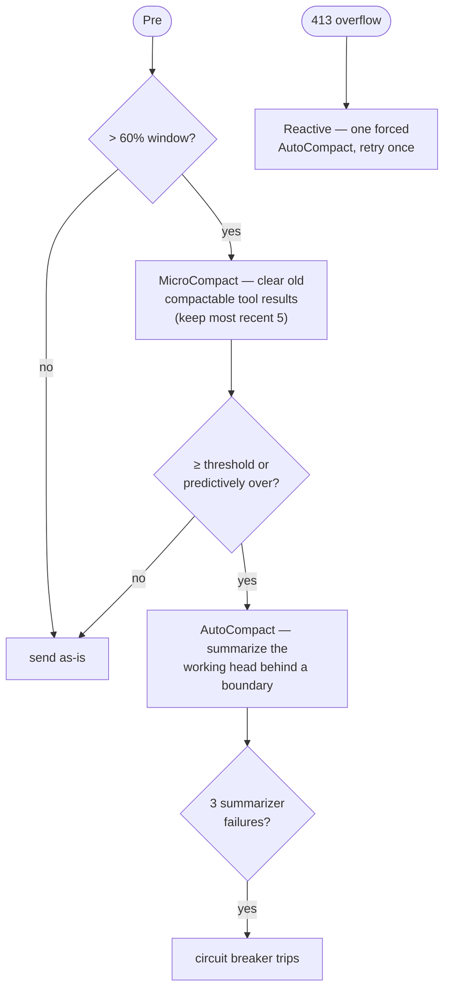

# Compaction

> Packages `compaction` and `noa` / `noaadapter`
> · `compaction/compaction.go`, `noaadapter/noa.go`

A long-running agent will eventually produce more conversation than fits the model's
context window. Norma handles this **non-destructively**: the full history is always
retained in the message array; only the projection sent to the provider shrinks. A
session has exactly one context manager — the built-in compactor **or** the
model-driven engine, never both (`agentcore.NewSession` enforces this).

## The harness contract

The loop talks to a context manager through the `harness.Compactor` interface:

- `Pre(ctx, msgs, lastInputTokens)` conditions history before a request.
- `Reactive(ctx, msgs)` force-compacts after an overflow error.
- `IsOverflow(err)` recognizes a prompt-too-long failure.

A compactor that also implements `harness.ContextView` builds the request message
array itself (replacing `llm.MessagesForAPI`) — the seam the model-driven engine uses.

## Built-in compaction

Enabled with `Options.Compaction = &compaction.Config{...}`. Three mechanisms run
from `Compactor.Pre` / `Reactive` (`compaction/compaction.go`):



- **MicroCompact** clears the bodies of stale *compactable* tool results — file reads,
  shell, grep/glob, web, edit/write — keeping the most recent five. A cleared result
  can be re-read, so nothing is lost.
- **AutoCompact** summarizes the messages between the last boundary and the preserved
  recent tail, inserts a `compact_boundary` marker plus the summary, and retains
  everything before it. Only messages after the last boundary are sent to the model.
  Thresholds derive from the window minus a summary reservation and a tiered buffer;
  a predictive check compacts *before* the next turn would overflow.
- **Reactive** handles an overflow error by forcing one AutoCompact and retrying the
  turn exactly once.
- A **circuit breaker** (`maxAutoCompactFails = 3`) stops retrying a summarizer that
  keeps failing, so a broken summarizer degrades gracefully instead of looping.

### Config

```go
compaction.Config{
    ContextWindow:   200000, // model window in tokens (default 200000)
    MaxOutputTokens: 8000,   // bounds the summary reservation (min(..,20000))
    KeepRecent:      8,      // un-summarized recent tail AutoCompact preserves
}
```

### Skills survive boundaries

Procedural skill instructions are lossy in a prose summary. When a boundary
summarizes over a skill invocation, AutoCompact re-injects the latest invocation of
each affected skill verbatim just after the summary — newest-first, under a per-skill
(5k) and total (25k) token budget — so standing guidance survives compaction
(`reinjectSkills`).

## Model-driven compression (`noa`)

`noa` is an opt-in alternative that inverts the model: instead of the harness writing
summaries, the **model** writes them through a `Compress` tool, and `noa` decides
*when* to compress, *which* range, tracks state, and prunes. The core
(`noa/`) is a pure library — no I/O, no model calls — so its only external dependency,
the summarizer, is reduced to a string argument. It plugs in as a `ContextView` that
projects the request view per turn without mutating history.

Enable it with the single, all-or-nothing entry point:

```go
err := noaadapter.Enable(&opts, noaadapter.Options{
    ArchiveBaseDir: "/path/to/archive", // REQUIRED: durable home for the originals
    SessionID:      id,
})
```

`Enable` attaches three things that must live or die together: a `Compactor`, the
`Compress` tool, and the resident prompt sections that teach the model how to write
good summaries. Enabling it disables the built-in compaction. Originals are preserved
in the archive directory (the only route back to compressed content), and compression
state can be inherited across forks and subagents via `ParentSessionIDs`.

`noa` is a port of acp-kernel; [noa upstream sync](noa-upstream-sync.md) records the
upstream baseline, every upstream change since, and what was ported, deferred or
skipped.

## Choosing

- **Built-in compaction** needs no extra tool and no archive; summaries are written by
  your provider automatically. Good default.
- **Model-driven (`noa`)** gives the model explicit control over what to keep and
  requires a durable archive directory; choose it when you want the agent itself to
  curate its context and you can host the archive.
