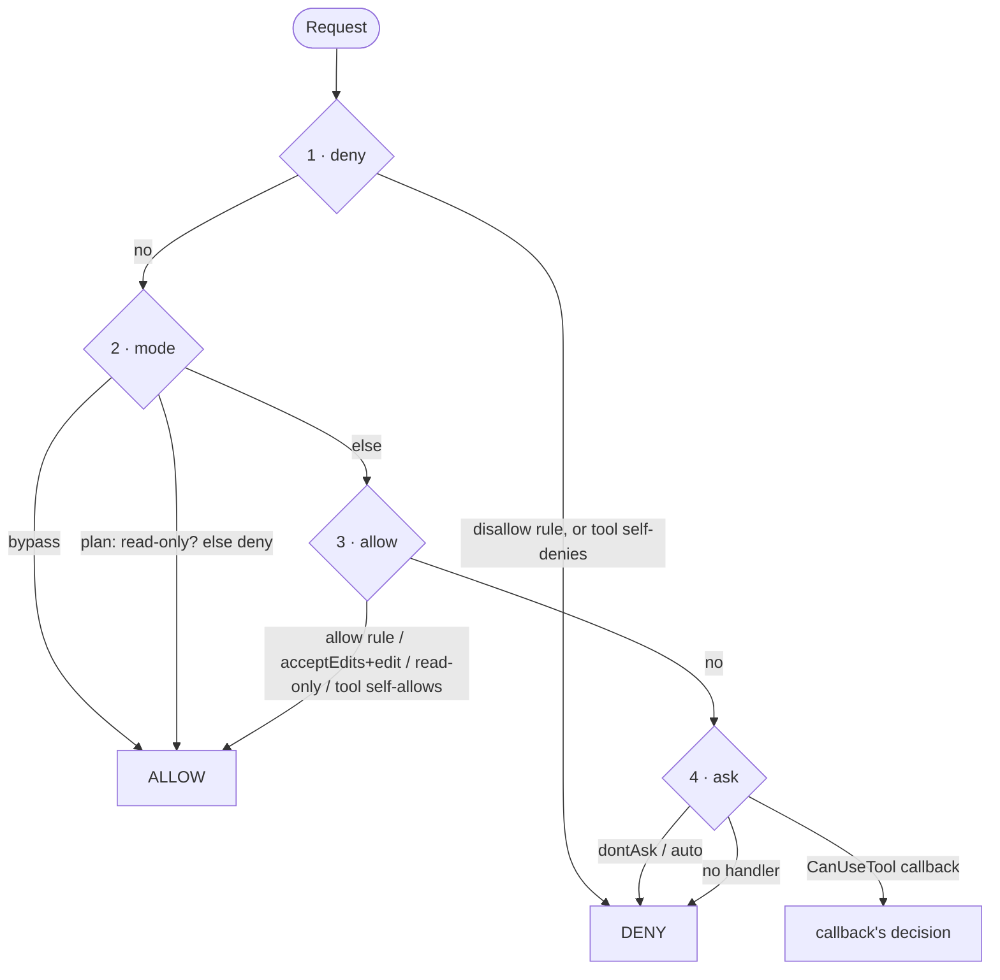

# Permissions

> Package `permission` · `permission/permission.go`

The permission package is Corvid's safety boundary. It decides, for every tool call,
whether to **allow**, **deny**, or **ask** — combining the tool's own verdict, the
host's rules, and the active mode into one decision.

## Decisions

A `Decision` carries a `Behavior` (`Allow` / `Deny` / `Ask`), an optional rewritten
input (`UpdatedInput`, e.g. a stripped flag), a `Message` (shown to the model on
deny, to the user on ask), and optional "always allow" `Suggestions` for the host to
persist. Build them with `Allowed()`, `Denied(msg)`, `AskUser(msg)`.

## The six modes

```go
ModeDefault     // ask for anything not read-only, unless a rule allows it
ModeAcceptEdits // auto-allow file edits (Write / Edit / NotebookEdit)
ModeBypass      // allow everything except explicit deny rules
ModePlan        // read-only tools only
ModeDontAsk     // never prompt: anything stage 3 does not allow is denied
ModeAuto        // never prompt; same outcome as dontAsk in Evaluate
```

`dontAsk` and `auto` reach the same decisions: both honor allow rules, read-only
tools and a tool's own `Allow` verdict (stage 3), and both deny whatever is left.
They differ only in the denial message and in `harness.StricterMode`, which ranks
`auto` as less strict when a subagent's mode is reconciled with its parent's.

## The four-stage pipeline

`permission.Evaluate(ctx, Request)` runs four stages in order. The order **is** the
policy: it encodes deny-priority, so an explicit deny beats every mode — including
bypass.



1. **Deny.** A matching disallow rule, or a tool that hard-denies (e.g. failed
   self-validation), is absolute.
2. **Mode short-circuits.** `bypassPermissions` allows; `plan` allows read-only and
   denies the rest.
3. **Allow.** A matching allow rule, `acceptEdits` for an edit tool, a read-only tool,
   or the tool's own `Allow` verdict.
4. **Ask.** `dontAsk` and `auto` refuse to prompt (deny). Otherwise the host's
   `CanUseTool` callback is consulted; with no callback configured, the call is
   denied.

## Rule matching

Rules live in `Options.AllowedTools` / `Options.DisallowedTools` and are matched in
`permission/rules.go`. A rule is `*` (any tool), a bare tool name, or `Name(spec)`.
The spec is matched against the call's *subject*: the first non-empty string among
the input fields `command`, `file_path`, `notebook_path`, `path` and `url`
(`permission.SubjectOf`), unless the host sets `Request.Subject`.

- `Name()` or `Name(*)` matches every call of the tool.
- `prefix:*` matches the prefix itself or the prefix followed by a space
  (`Bash(git:*)` matches `git status`, not `gitk`).
- A spec with `*` is a glob in which `*` also crosses `/` (`Read(/src/*)` covers the
  whole tree).
- Anything else must match exactly.

Unclear cases fail safe. A spec on a call that has no subject never allows and always
denies. A shell command that chains or substitutes commands (`;`, `&`, `|`, `$(`,
backticks, redirects, newlines) never matches an allow spec, so `Bash(git:*)` does not
allow `git status; rm -rf ~`; a deny spec matches if any command in the chain does.

## Where it plugs in

The harness calls `Evaluate` for every tool call inside `execOne`
(`harness/tools.go`), passing the tool's `IsReadOnly` result and its
`CheckPermissions` verdict. A non-allow decision becomes a synthetic error
`tool_result` (`CodePermissionDenied`) — so a denied call never breaks the
`tool_use`/`tool_result` pairing the provider requires.

Plan mode (see [the architecture overview](../ARCHITECTURE.md#7-mcp-skills-memory-plan-mode-hooks))
changes the active mode mid-loop through `QueryInput.PermissionModeFunc`, which the
harness reads fresh for each call. A subagent runs in the stricter of its own mode and
its parent's, and inherits the parent's rules (see the
[subagents guide](subagents.md)).
