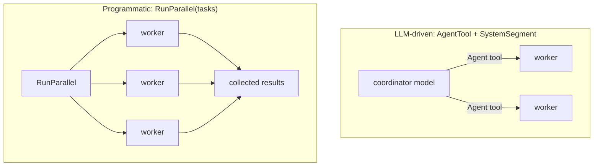

# Subagents and coordination

> Packages `subagent` and `coordinator`
> · `subagent/subagent.go`, `coordinator/coordinator.go`

## Subagents

A **subagent** is the same harness loop run with its own system prompt, tool subset,
and permission mode. That gives **context isolation**: the child works in a fresh
conversation and reports back a summary, so the parent's context is not flooded with
the child's intermediate steps.

A subagent is exposed to the parent model as a single `Agent` tool
(`subagent.Config`). Define the available agents by name:

```go
subagent.Config{
    Provider:    prov,
    ParentTools: registry,
    Agents: map[string]subagent.Definition{
        "explorer": {
            Description:    "Read-only codebase explorer.",
            Prompt:         []string{"You explore and report; you never edit."},
            Tools:          []string{"Read", "Glob", "Grep"}, // empty = inherit all
            PermissionMode: permission.ModePlan, // can only tighten the parent's mode
            MaxTurns:       20,
        },
    },
    MaxDepth: 3, // recursion guard, default 3
}
```

`subagent.NewTool(cfg)` builds the `Agent` tool; add it to the parent's
`Options.Tools`. `subagent.Run` runs a named agent straight from Go code, with no
parent model deciding to call it (the coordinator's `RunParallel` uses it). `Config`
also takes the `CanUseTool` callback and `Hooks` the children use, and a `Transcript`
store.

A child started from a tool call inherits the calling run's deny and allow rules,
`BashEnv`, output-spill settings, tracer, `OnToolResult`, `RewriteToolResult` and
`Settlement`, and runs in the stricter of its own and its parent's permission mode
(`harness.StricterMode`). Delegation never loosens the policy.

Recursion is bounded by a depth guard carried on the `context.Context`
(`MaxDepth`), so a subagent that spawns subagents cannot recurse without limit. When a
`transcript.Store` is configured, each subagent run is persisted to its own sidechain
file under the parent session. Its token usage is kept apart from the parent's own:
the parent's `Terminal.SubagentUsage` sums everything its subagents used, all the way
down, while `Terminal.Usage` counts only the parent's model calls.

## Coordinator mode

**Coordinator mode** is a pattern built on subagents: a top-level agent that
*decomposes* work and delegates each unit to isolated `worker` subagents instead of
doing the work itself. Two paths, from one `coordinator.Config`:



- **LLM-driven.** Expose the coordinator's `AgentTool()` plus its `SystemSegment()` so
  the model spawns workers itself, deciding how to split the work.
- **Programmatic.** `RunParallel(tasks)` fans a known set of tasks out to workers
  concurrently — bounded by `MaxParallel` (default 4) — and returns their results for
  the caller to synthesize.

Workers run with their own prompt (`DefaultWorkerPrompt` unless overridden), permission
mode (default `acceptEdits`), and per-worker turn cap. The subagent depth guard
(`MaxDepth`, default 3) still applies.

See the runnable [`examples/coordinator`](../../examples/coordinator/) and
[`examples/security-audit`](../../examples/security-audit/) (a read-only auditor that
delegates to a subagent).
